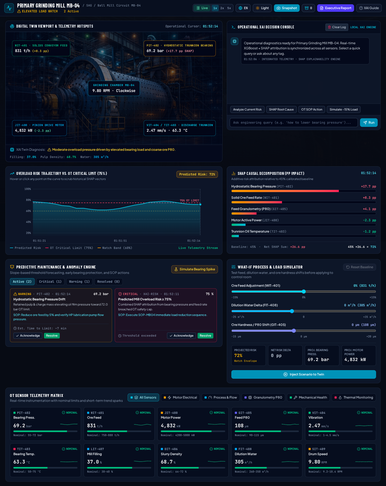
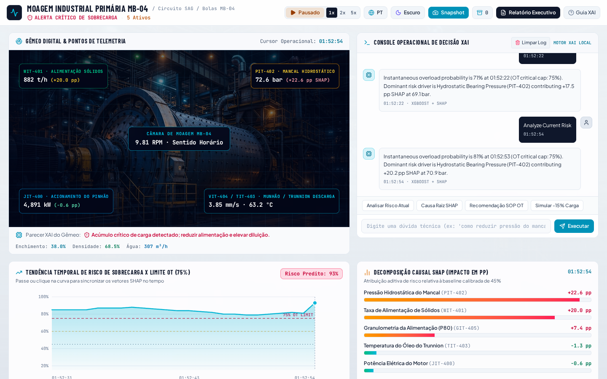
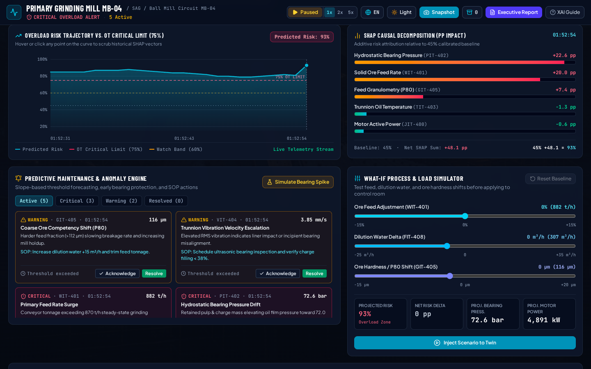
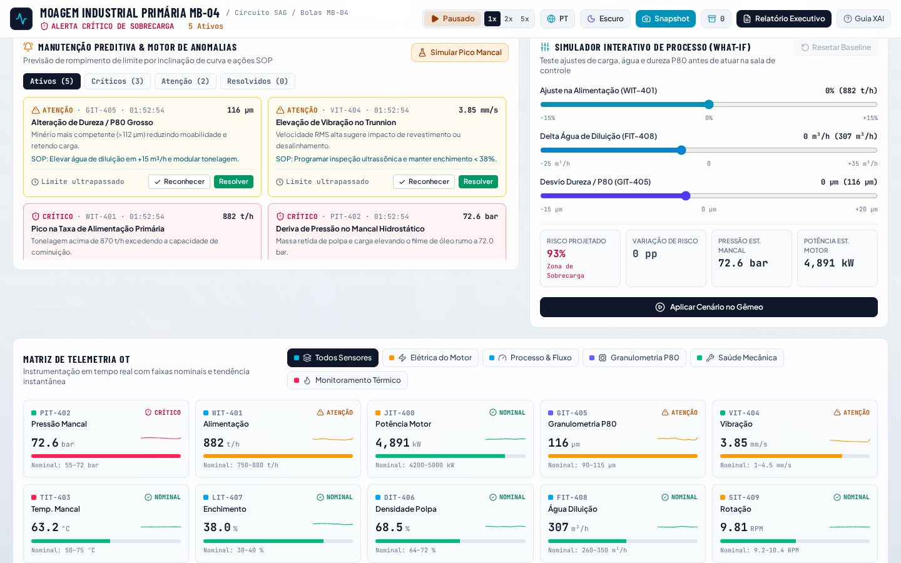
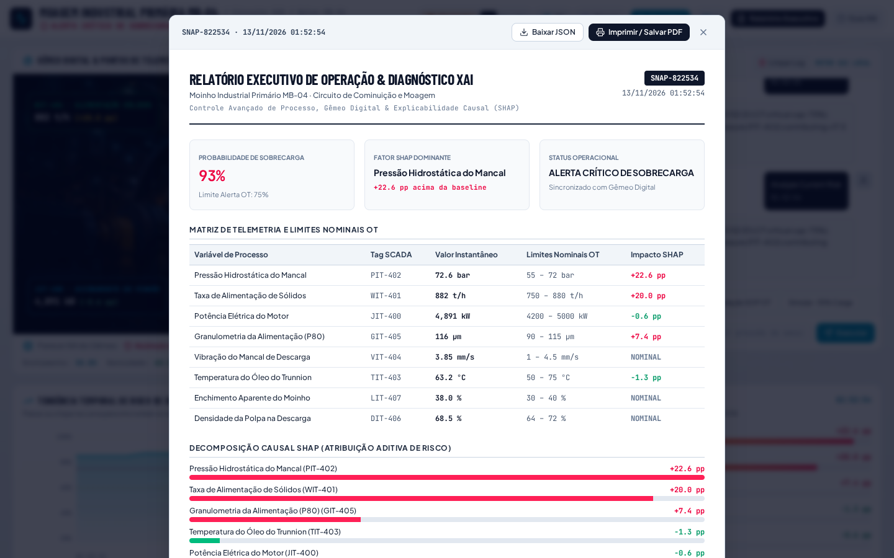

# MB-04 Industrial Mill Monitor

Interactive real-time telemetry, **Explainable AI (SHAP)** diagnostics, and **predictive maintenance** dashboard for **Primary Grinding Mill MB-04** (SAG / Ball Mill Circuit), built with **React**, **TypeScript**, and **Tailwind CSS**.

---

## Application Snapshots

### 1. Full Dashboard Overview (Dark Mode · English)
Includes the Digital Twin viewport with interactive sensor hotspots, local Operational XAI Decision Console, Overload Risk Trajectory (`75%` OT critical limit), SHAP Causal Decomposition (`45%` baseline), Predictive Maintenance Engine, What-If Simulator, and OT Sensor Telemetry Matrix.



### 2. Digital Twin & XAI Console (Light Mode · Português)
Theme-calibrated light interface with full `PT-BR` localization, centered grinding chamber RPM callout, and live XAI diagnosis strip.



### 3. Predictive Maintenance Engine & What-If Process Simulator
Slope-based threshold forecasting with estimated time-to-limit (ETA), SOP-MB04 corrective actions, acknowledge/resolve workflows, and interactive feed/water/P80 simulation sliders.



### 4. OT Sensor Telemetry Matrix & Subsystem Filters (Light Mode)
Filterable 10-sensor SCADA matrix grouped by subsystem (*Motor Electrical*, *Process & Flow*, *Granulometry P80*, *Mechanical Health*, *Thermal Monitoring*) with inline SVG trend sparklines and nominal envelope progress bars.



### 5. Print-Ready Executive Operation & XAI Report
Snapshot-backed executive report with KPI cards, SCADA nominal limits table, SHAP attribution breakdown, engineering prescriptions, JSON download, and `Print / Save PDF` support.



---

## Key Capabilities

- **Digital Twin Viewport (`MB-04`)**: Interactive mill stage displaying live cylinder speed (`RPM`), mill charge filling, slurry density, dilution water flow, and clickable telemetry hotspots (`WIT-401`, `PIT-402`, `JIT-400`, `VIT-404 / TIT-403`).
- **Live Simulation & Historical Cursor Scrubbing**: Toggle **Live / Paused** telemetry at `1x`, `2x`, or `5x` speed, or hover/click any point on the **Overload Risk Trajectory** SVG chart to inspect historical SHAP vectors and Digital Twin states.
- **SHAP Causal Decomposition**: Computes additive Shapley (`pp`) risk contributions relative to a `45%` calibrated baseline, highlighting risk-driving variables (`+pp`) and stabilizing variables (`-pp`).
- **Predictive Maintenance & Anomaly Engine**: Monitors value thresholds and rate-of-change slopes to predict time-to-limit (`ETA`) across bearing pressure, feed tonnage, vibration RMS, oil temperature, P80 particle size, and overall overload risk—with active/critical/warning/resolved filters and a **Simulate Bearing Spike** test trigger.
- **What-If Process & Load Simulator**: Interactive sliders for ore feed adjustment (`-15%` to `+15%`), dilution water delta (`-25` to `+35 m³/h`), and ore hardness / P80 shift (`-15` to `+20 µm`) to preview projected bearing pressure, motor power, and overload risk before applying to the twin.
- **Operational XAI Decision Console**: Deterministic local diagnostics engine supporting quick engineering queries, hotspot click-to-diagnose, and custom tag inquiries.
- **Snapshots & Exports**: Capture operational states in memory, restore snapshots onto the Digital Twin, export `JSON` or `CSV` datasets, and generate printable executive reports.
- **Dual Theme & Bilingual UI**: Instant switching between **Dark / Light** mode and **English (`EN`) / Portuguese (`PT-BR`)**.

---

## Monitored SCADA Telemetry Tags

| Tag | Process Variable | Subsystem | Nominal OT Envelope |
| :--- | :--- | :--- | :--- |
| `JIT-400` | Motor Active Power | Motor Electrical | `4,200 – 5,000 kW` |
| `SIT-409` | Cylinder Rotational Speed | Motor Electrical | `9.20 – 10.40 RPM` |
| `WIT-401` | Solid Ore Feed Rate | Process & Flow | `750 – 880 t/h` |
| `LIT-407` | Apparent Mill Charge Filling | Process & Flow | `30.0 – 40.0 %` |
| `DIT-406` | Discharge Slurry Density | Process & Flow | `64.0 – 72.0 %` |
| `FIT-408` | Feed Chute Dilution Water | Process & Flow | `260 – 350 m³/h` |
| `GIT-405` | Feed Granulometry (`P80`) | Granulometry P80 | `90 – 115 µm` |
| `PIT-402` | Hydrostatic Bearing Pressure | Mechanical Health | `55.0 – 72.0 bar` |
| `VIT-404` | Discharge Bearing Vibration | Mechanical Health | `1.00 – 4.50 mm/s` |
| `TIT-403` | Trunnion Oil Temperature | Thermal Monitoring | `50.0 – 75.0 °C` |

---

## Tech Stack

- **Frontend**: React 19, TypeScript, Vite
- **Styling**: Tailwind CSS v4 (`@custom-variant dark`), custom `Barlow Condensed` + `Plus Jakarta Sans` + `JetBrains Mono` typography
- **Icons & Graphics**: `lucide-react`, bespoke interactive SVG time-series charts and sparklines

---

## Getting Started

```bash
# Install dependencies
npm install

# Start development server (port 3000)
npm run dev

# Type-check with TypeScript
npm run lint

# Build for production
npm run build
```

---

## Project Structure

```text
├── docs/screenshots/             # Dashboard snapshots used in README
├── public/assets/mill-mb04.jpg   # Mill MB-04 visual asset for background & Digital Twin
└── src/
    ├── components/
    │   ├── DiagnosticsConsole.tsx
    │   ├── DigitalTwinPanel.tsx
    │   ├── HeaderBar.tsx
    │   ├── OverloadTrendChart.tsx
    │   ├── PredictiveAlertsPanel.tsx
    │   ├── PrintableReportModal.tsx
    │   ├── ScenarioSimulator.tsx
    │   ├── SensorMatrix.tsx
    │   ├── ShapBreakdownPanel.tsx
    │   ├── SnapshotsModal.tsx
    │   └── XaiGuideModal.tsx
    ├── i18n/translations.ts      # EN & PT-BR localization dictionary
    ├── types/mill.ts             # Domain TypeScript interfaces
    ├── utils/simulationEngine.ts # Telemetry physics, SHAP math, predictive alerts & What-If engine
    ├── App.tsx
    ├── index.css
    └── main.tsx
```
